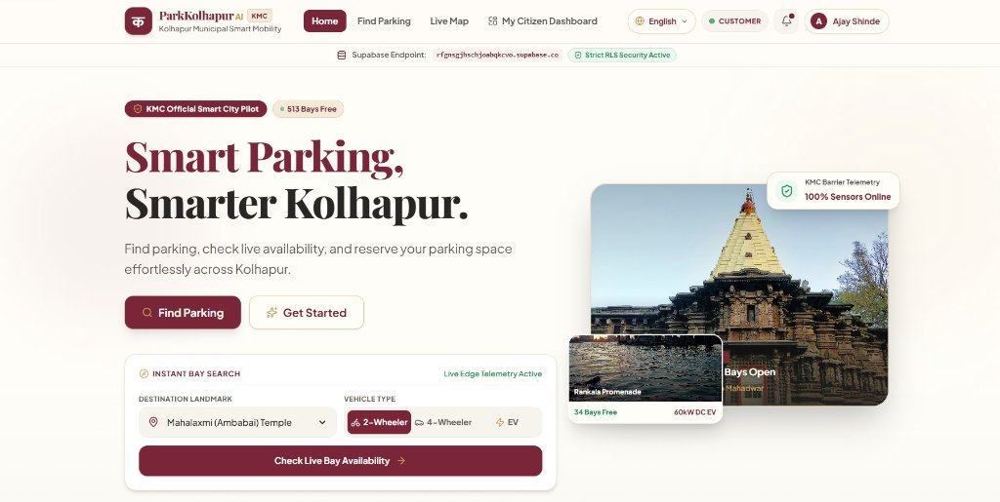

<div align="center">
  
  
  # ParkNExplore (पार्क अँड एक्सप्लोर)
  ### Smart Municipal Parking & Heritage Tourism Mobility Platform for Kolhapur
  
  [](https://vitejs.dev/)
  [](https://react.dev/)
  [](https://tailwindcss.com/)
  [](#)
</div>

---

## 🏛️ Overview

**ParkNExplore** is an intelligent municipal parking guidance and destination bay reservation ecosystem authorized for **Kolhapur Municipal Corporation (KMC)** under the Smart City Mission. 

It seamlessly bridges smart urban mobility with heritage tourism across Kolhapur's iconic pilgrimage sites, historic wrestling arenas, ancient hill forts, and wildlife sanctuaries.

<div align="center">
  
</div>

---

## ✨ Key Capabilities

- 🛰️ **Realtime Satellite View & Orbital Telemetry**:
  - Live pan/zoom satellite orthoimagery (Google Satellite embed).
  - Orbital sensor radar grid displaying active GPS coordinates and low-latency telemetry.
  - Direct deep-link to 3D Google Earth (`!1e3`).
- 📍 **Authentic Kolhapur Heritage Landmarks**:
  - **Shri Mahalaxmi (Ambabai) Temple** — Core pilgrimage sanctum with free electric shuttle corridor pass.
  - **Shri Jyotiba Temple (Wadi Ratnagiri)** — Gulal-adorned hilltop sanctum with high-capacity pilgrim transit.
  - **Swargamandapa, Kopeshwar Temple (Khidrapur)** — Iconic open-to-sky circular celestial pavilion on Krishna riverbank.
  - **Siddhagiri Gramjivan Museum (Kaneri Math)** — Sculptural village heritage museum and eco-spiritual retreat.
  - **Radhanagari Wildlife Sanctuary & Dajipur Bison Reserve** — Eco-tourism gateway.
  - **Town Hall Archaeological Museum & Botanical Gardens** — Satavahana antiquity museum in Victorian gardens.
  - **Narsobachi Wadi (Dattatreya Pilgrimage & Sangam Ghat)** — Sacred Krishna-Panchaganga confluence.
  - **Rajarshi Chhatrapati Shahu Khasbag Maidan** — Historic red-soil wrestling arena.
- ⚡ **Smart Bay Reservation & FASTag Telemetry**:
  - 2-Wheeler, 4-Wheeler, and fast EV charging bay reservations.
  - Live barrier sensors tracking open bays with dynamic edge node updates.
- 🌐 **Trilingual Localization**:
  - Complete native interface supporting **मराठी (Marathi)**, **हिंदी (Hindi)**, and **English**.

---

## 🚀 Getting Started

### Prerequisites
- [Node.js](https://nodejs.org/) (v18 or newer)
- npm or pnpm

### Quick Setup

```bash
# 1. Clone the repository
git clone https://github.com/shravanimahind1234/parkkolhapur-ai.git
cd parkkolhapur-ai

# 2. Install dependencies
npm install

# 3. Configure environment variables (optional for local mock mode)
cp .env.example .env.local

# 4. Start the development server
npm run dev
```

Visit `http://localhost:3000` (or `http://localhost:3001`) in your browser.

---

## 🏗️ Technology Stack

- **Frontend**: React 19, TypeScript, Vite
- **Styling**: Tailwind CSS v4 with bespoke Royal Kolhapur theme (`#7B2638` Crimson, `#C6A15B` Imperial Gold, `#F7F4EE` Cream)
- **Icons & Graphics**: Lucide Icons, Custom SVG Brand Vectors (`ParkNExploreLogo.tsx`)
- **Backend & Auth**: Supabase (Row-Level Security & Postgres), Google GenAI SDK

---

## 📜 License & Municipal Credits

Authorized for Kolhapur Municipal Corporation (KMC) Smart City Mission.  
© 2026 Kolhapur Municipal Corporation. All rights reserved.
